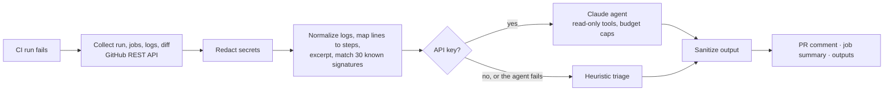

# CI Triage Agent

**When CI goes red, an AI agent reads the logs, the diff and the job history, and tells you on the pull request what broke, why, and how to fix it.**

[](https://github.com/eaarrll/ci-triage-agent/actions/workflows/ci.yml)


<!-- SCREENSHOT -->

Most red builds come down to a handful of causes: the change broke a test, a test is flaky, a lockfile
drifted, the runner ran out of memory or disk, a cloud credential or permission is wrong, or the workflow
itself is misconfigured. Finding which one usually means scrolling through thousands of log lines across
several jobs. This action does that investigation for you and posts a short, evidence-backed answer:

- **Root cause** in one or two sentences, with the exact log lines (job + line number) that prove it
- **Category**: `code` · `flaky` · `dependency` · `infrastructure` · `cloud_auth` · `configuration`
- **Suggested fix**, linked to the file and line to change when there is one
- **Flaky detection** from the job's history on the default branch and other attempts of the same commit
- **Cost of the run** in the footer (typically a few cents)

It understands cloud and platform failures, not just test output: Terraform state locks, AWS `AccessDenied`
/ `iam:PassRole`, Azure OIDC federated-credential mismatches, quota limits, OOM kills (exit 137), full disks,
Docker Hub rate limits, `ImagePullBackOff`, missing secrets on fork PRs, and more.

## Quick start

1. Add an Anthropic API key as a repository secret named `ANTHROPIC_API_KEY`.
2. Add this workflow next to your CI workflow:

```yaml
# .github/workflows/ci-triage.yml
name: CI triage

on:
  workflow_run:
    workflows: [CI] # the name(s) of the workflow(s) to watch
    types: [completed]

permissions:
  actions: read # runs, jobs and logs
  contents: read # files at the failing commit
  pull-requests: write # the triage comment

concurrency: # one triage at a time per workflow and branch
  group: ci-triage-${{ github.event.workflow_run.workflow_id }}-${{ github.event.workflow_run.head_repository.full_name }}-${{ github.event.workflow_run.head_branch }}

jobs:
  triage:
    if: contains(fromJSON('["failure", "timed_out", "success"]'), github.event.workflow_run.conclusion)
    runs-on: ubuntu-latest
    timeout-minutes: 10
    steps:
      - uses: eaarrll/ci-triage-agent@v1
        with:
          anthropic-api-key: ${{ secrets.ANTHROPIC_API_KEY }}
```

That's it. Failures get a comment on the PR (and a job summary on every run); when the workflow passes
again, the comment is marked as resolved. `workflow_run` runs in the base repository's context, so it also
works for pull requests from forks, and this action never checks out or executes PR code.

Prefer a single workflow? Run it as a last job with `needs: [...]` and `if: always()`; see
[`examples/same-workflow.yml`](examples/same-workflow.yml).

## How it works



**Deterministic first, agent second.** Before the model sees anything, the action strips ANSI codes and
timestamps, attributes every log line to its step by timestamp, picks the ~160 lines most likely to explain
each failed job (error markers, assertions, stack traces, the tail of the failed step), and matches 30 known
failure signatures. The agent starts from that, not from a 20 MB log.

**Then it investigates.** The agent has six read-only tools and decides what to look at:

| Tool              | What it does                                                                       |
| ----------------- | ---------------------------------------------------------------------------------- |
| `search_log`      | Literal or regex search in any job's log, with context and step filters            |
| `read_log`        | Read a numbered line range of a log                                                |
| `read_file`       | Read a file at the failing commit or on the default branch                         |
| `list_directory`  | List a directory at either ref                                                     |
| `get_file_diff`   | The PR's patch for one changed file                                                |
| `get_job_history` | Recent outcomes of the job on the default branch and other attempts of this commit |

A typical investigation takes 2–6 tool calls: confirm the error, read the code it points at, tie it to the
diff, or check history when the failure looks unrelated to the change.

**Guardrails.**

- **Secrets never leave the runner unredacted.** Every log, file, patch and title passes through a redactor
  for 20+ secret formats (GitHub, AWS, Azure, GCP, Anthropic/OpenAI, Slack, Stripe, npm, JWTs, PEM keys, URL
  credentials, kubeconfig and Docker auth, generic `password=` assignments) before it reaches the model.
- **Logs are treated as untrusted data.** A failing test can print anything, including instructions aimed
  at an AI. The system prompt says so, and the output is sanitized before it is posted: no `@mentions`, no
  raw HTML, no images, and no clickable links from model text (URLs are rendered as code).
- **Bounded cost and time.** Turn, dollar and wall-clock limits (`max-turns`, `max-cost-usd`,
  `timeout-seconds`). When a limit is near, the agent is asked for its best answer from the evidence so far.
- **Fails open.** Action errors are warnings, never a red build. If the agent errors, refuses or there is no
  API key, the heuristic triage still produces a comment.

## Evals

The agent is scored on 17 recorded failures: realistic GitHub Actions logs, repository files, diffs and job
history for code regressions, dependency conflicts, a flaky test, Terraform, AWS, Azure, Kubernetes, Docker,
fork-PR secrets, a secret echoed into a log, and a prompt-injection attempt. A case passes only when the
category is right, the explanation names the actual cause, the fix points at the right file where there is
one, and nothing forbidden (an injected URL, a leaked secret) appears in the answer.

<!-- EVAL_TABLE -->

Reproduce with `npm run eval -- --model claude-opus-5-5` (needs `ANTHROPIC_API_KEY`) or the free baseline
with `npm run eval -- --heuristic`. Fixtures, grading rules and per-case results are in [`evals/`](evals/).

## Inputs

| Input                | Default           | Description                                                       |
| -------------------- | ----------------- | ----------------------------------------------------------------- |
| `anthropic-api-key`  |                   | Anthropic API key. Empty = heuristic mode (no AI, no cost).       |
| `github-token`       | `github.token`    | Needs `actions: read`, `contents: read`, `pull-requests: write`.  |
| `model`              | `claude-opus-5-5` | Claude model ID, e.g. `claude-sonnet-5-5` or `claude-haiku-5-5`.  |
| `effort`             | `medium`          | `low`, `medium`, `high`, `xhigh` or `max`.                        |
| `run-id`             | triggering run    | Run to triage.                                                    |
| `comment`            | `true`            | Post or update a comment on the PR.                               |
| `resolve-on-success` | `true`            | Mark the earlier comment resolved when the workflow passes again. |
| `max-turns`          | `12`              | Agent turn limit (1–50).                                          |
| `max-cost-usd`       | `0.50`            | Stop investigating at this estimated spend.                       |
| `timeout-seconds`    | `300`             | Time budget (30–1800).                                            |
| `max-failed-jobs`    | `4`               | Failed jobs to collect logs for (1–10).                           |
| `fail-on-error`      | `false`           | Fail the step on internal errors instead of warning.              |
| `extra-instructions` |                   | Repository hints for the agent (≤ 4000 chars).                    |

## Outputs

`category`, `confidence`, `title`, `root-cause`, `suggested-fix`, `flaky-suspected`, `mode`
(`agent` · `heuristic` · `resolved` · `skipped` · `error`), `cost-usd`, `comment-url`, `result-json`.

> [!WARNING]
> `title`, `root-cause`, `suggested-fix` and `result-json` contain model-written text derived from untrusted
> logs. Pass them to later steps through `env:`, never by interpolating `${{ steps.x.outputs.title }}`
> directly into a `run:` script.

## Data and privacy

The redacted log excerpts, the files and patches the agent chooses to read, and run metadata (workflow, job
and step names, branch, commit SHA) are sent to the Anthropic API under your API key and its data policy.
Nothing is sent anywhere else. Without an API key, nothing leaves GitHub.

## Limitations

- It reads logs, files and diffs through the API; it does not reproduce failures or run code.
- Runs from forks get a comment only in `workflow_run` mode (secrets and write tokens are not available to
  fork-triggered workflows).
- GitHub keeps logs for a limited time; very old runs cannot be triaged.
- Redaction is pattern-based. Secrets with no recognizable shape (say, a passphrase printed on its own line)
  can still reach the model, so do not print secrets in CI logs.

## Development

```bash
npm ci
npm run all        # typecheck, lint, tests, build
npm run eval -- --heuristic
```

`dist/index.js` is the bundled action and is committed; CI fails if it is out of date.

## License

MIT
