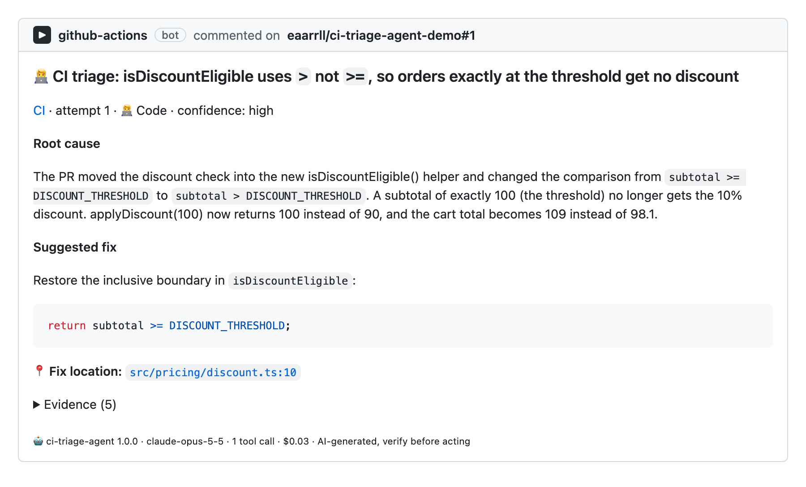
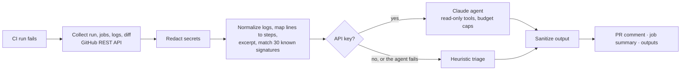

# CI Triage Agent

**When CI goes red, an AI agent reads the logs, the diff and the job history, and tells you on the pull request what broke, why, and how to fix it.**

[](https://github.com/eaarrll/ci-triage-agent/actions/workflows/ci.yml)


<p align="center">
  <a href="https://github.com/eaarrll/ci-triage-agent-demo/pull/1"> not >=, with root cause, fix and the file and line to change" width="760"></a>
</p>

**See it on real failures.** Each pull request in the
[demo repository](https://github.com/eaarrll/ci-triage-agent-demo/pulls) breaks CI on purpose, on
GitHub-hosted runners, and carries the agent's comment:

| PR                                                           | What broke                                       | What the agent said                                                              |
| ------------------------------------------------------------ | ------------------------------------------------ | -------------------------------------------------------------------------------- |
| [#1](https://github.com/eaarrll/ci-triage-agent-demo/pull/1) | a refactor turned `>=` into `>`                  | `code`: names the helper and the line, and the 100 → 90 and 109 → 98.1 mismatch  |
| [#2](https://github.com/eaarrll/ci-triage-agent-demo/pull/2) | `zod` added without updating the lockfile        | `dependency`: `npm ci` EUSAGE, regenerate the lockfile                           |
| [#3](https://github.com/eaarrll/ci-triage-agent-demo/pull/3) | the report job now runs out of heap              | `configuration`: `REPORT_ORDERS` ×10 against a 128 MB heap cap, with three fixes |
| [#4](https://github.com/eaarrll/ci-triage-agent-demo/pull/4) | image tag `1.28-apline` on a real `kind` cluster | `code`: the typo, from the kubelet's `ImagePullBackOff` events                   |

Most red builds come down to a handful of causes: the change broke a test, a test is flaky, a lockfile
drifted, the runner ran out of memory or disk, a cloud credential or permission is wrong, or the workflow
itself is misconfigured. Finding which one usually means scrolling through thousands of log lines across
several jobs. This action does that investigation for you and posts a short, evidence-backed answer:

- **Root cause** in one or two sentences, with the exact log lines (job + line number) that prove it
- **Category**: `code` · `flaky` · `dependency` · `infrastructure` · `cloud_auth` · `configuration`
- **Suggested fix**, linked to the file and line to change when there is one
- **Flaky detection** from the job's history on the default branch and other attempts of the same commit
- **Cost of the run** in the footer (typically a few cents)

It understands cloud and platform failures, not just test output: Terraform state locks, AWS `AccessDenied`
/ `iam:PassRole`, Azure OIDC federated-credential mismatches, quota limits, OOM kills (exit 137), full disks,
Docker Hub rate limits, `ImagePullBackOff`, missing secrets on fork PRs, and more.

## Quick start

1. Add an Anthropic API key as a repository secret named `ANTHROPIC_API_KEY`.
2. Add this workflow next to your CI workflow:

```yaml
# .github/workflows/ci-triage.yml
name: CI triage

on:
  workflow_run:
    workflows: [CI] # the name(s) of the workflow(s) to watch
    types: [completed]

permissions:
  actions: read # runs, jobs and logs
  contents: read # files at the failing commit
  pull-requests: write # the triage comment

concurrency: # one triage at a time per workflow and branch
  group: ci-triage-${{ github.event.workflow_run.workflow_id }}-${{ github.event.workflow_run.head_repository.full_name }}-${{ github.event.workflow_run.head_branch }}

jobs:
  triage:
    if: contains(fromJSON('["failure", "timed_out", "success"]'), github.event.workflow_run.conclusion)
    runs-on: ubuntu-latest
    timeout-minutes: 10
    steps:
      - uses: eaarrll/ci-triage-agent@v1
        with:
          anthropic-api-key: ${{ secrets.ANTHROPIC_API_KEY }}
```

That's it. Failures get a comment on the PR and a job summary; when the workflow passes again, the
comment is marked as resolved. `workflow_run` runs in the base repository's context, so it also
works for pull requests from forks, and this action never checks out or executes PR code.

Prefer a single workflow? Run it as a last job with `needs: [...]` and `if: ${{ !cancelled() }}`; see
[`examples/same-workflow.yml`](examples/same-workflow.yml).

## How it works



**Deterministic first, agent second.** Before the model sees anything, the action strips ANSI codes and
timestamps, attributes every log line to its step by timestamp, picks the ~160 lines most likely to explain
each failed job (error markers, assertions, stack traces, the tail of the failed step), and matches 30 known
failure signatures. The agent starts from that, not from a 20 MB log.

**Then it investigates.** The agent has six read-only tools and decides what to look at:

| Tool              | What it does                                                                       |
| ----------------- | ---------------------------------------------------------------------------------- |
| `search_log`      | Literal or regex search in any job's log, with context and step filters            |
| `read_log`        | Read a numbered line range of a log                                                |
| `read_file`       | Read a file at the failing commit or on the default branch                         |
| `list_directory`  | List a directory at either ref                                                     |
| `get_file_diff`   | The PR's patch for one changed file                                                |
| `get_job_history` | Recent outcomes of the job on the default branch and other attempts of this commit |

A typical investigation takes 2–6 tool calls: confirm the error, read the code it points at, tie it to the
diff, or check history when the failure looks unrelated to the change.

**Guardrails.**

- **Secrets never leave the runner unredacted.** Every log, file, patch and title passes through a redactor
  for 20+ secret formats (GitHub, AWS, Azure, GCP, Anthropic/OpenAI, Slack, Stripe, npm, JWTs, PEM keys, URL
  credentials, kubeconfig and Docker auth, generic `password=` assignments) before it reaches the model.
- **Logs are treated as untrusted data.** A failing test can print anything, including instructions aimed
  at an AI. The system prompt says so, and the output is sanitized before it is posted: no `@mentions`, no
  raw HTML, no images, and no clickable links from model text (URLs are rendered as code).
- **Bounded cost and time.** Turn, dollar and wall-clock limits (`max-turns`, `max-cost-usd`,
  `timeout-seconds`). When a limit is near, the agent is asked for its best answer from the evidence so far.
- **Fails open.** Once its inputs are valid, the action never turns a build red: its own errors are
  warnings (unless you set `fail-on-error`). If the agent errors, refuses or there is no API key, the
  heuristic triage still produces a comment. Invalid inputs do fail the step, because they are a workflow
  bug.

## Evals

The agent is scored on 25 recorded failures: realistic GitHub Actions logs, repository files, diffs and job
history, each with a known right answer. A case passes only when the category is right, the explanation names
the actual cause, the fix points at the right file where there is one, and nothing forbidden (an injected URL, a
leaked secret) appears in the answer.

- **Original set (17):** code regressions, dependency conflicts, a flaky test, Terraform, AWS, Azure,
  Kubernetes, Docker, fork-PR secrets, a secret echoed into a log, and a prompt-injection attempt.
- **Hard set (8, added 2026-11-24):** cases built so that a shallow read gives the wrong answer. A Docker rate
  limit and a cache timeout in steps that succeeded, while the real failure is a rounding regression. An
  unrelated flaky job that fails first, next to a type error the PR caused. A deploy that fails because of a
  tsconfig change that only shows in the build job. A test listed as known-flaky that now fails every time. An
  S3 `AccessDenied` whose real cause is a missing KMS permission. A 4,400-line log whose decisive line is
  outside the excerpt. A job timeout caused by a leaked timer. A failure inside the PR's own function that an
  unpinned dependency's new major release caused.

| Mode                      | Original set (17 × 3 runs) | Hard set (8 × 3 runs) | Evidence verified (hard set) | Cost per triage       | Median time    | Model turns |
| ------------------------- | -------------------------- | --------------------- | ---------------------------- | --------------------- | -------------- | ----------- |
| Heuristic only, no AI     | 4 / 17                     | 0 / 8                 | 23 / 23                      | $0                    | 6 ms           | –           |
| Claude Haiku 5.5          | **51 / 51**                | **24 / 24**           | 76 / 79                      | **$0.0010 / $0.0016** | 6.3 s / 8.5 s  | 2.2 / 3.0   |
| Claude Sonnet 5.5         | **51 / 51**                | **24 / 24**           | 92 / 92                      | $0.024 / $0.025       | 9.9 s / 9.5 s  | 6.0 / 5.4   |
| Claude Opus 5.5 (default) | **51 / 51**                | **24 / 24**           | **98 / 98**                  | $0.033 / $0.043       | 8.9 s / 10.1 s | 2.4 / 2.9   |

Cost, time and turns are original set / hard set. All at `effort: medium`, measured 2026-11-24
([per-case results](evals/results/); the hard set's reports end in `-medium-hard`, and a second run at
`effort: low` in `-low-hard`). The hard-set figures come from the run that added the evidence check; an earlier
run of the same set also scored 24/24 on every model. "Evidence verified" counts cited quotes found where the
agent could have seen them, at the line they name ([how](evals/README.md#evidence-check)); it doesn't affect
whether a case passes.

What the numbers do and don't say:

- **The heuristic baseline is the floor.** Signature matching names the right category for 11 of the 17
  original failures but only 1 of the 8 hard ones, and passes none of the hard set: there, the signature
  hints point the wrong way by design. It can't connect a failure to the change that caused it.
- **The hard set did not separate the models either.** All three passed all 24 hard runs, and not by keyword
  luck: reading the 72 answers, each one names the real mechanism (the floored day count, the moved build
  output, the `time.Second` unit, the missing `kms:GenerateDataKey`, the unpinned major release), gets the
  flaky flag right, and the two-failure answers also account for the flaky job. Both sets now work as
  regression suites for the harness, tools, redaction and injection resistance, not as a ranking.
- **Where the models differ is effort, not accuracy.** Sonnet investigated the most (5.4 turns on the hard
  set, up to 12 on one case) without being more accurate. Haiku and Opus settled most hard cases in 2 to 4
  turns, and Opus reported high confidence on all 24.
- **Lowering effort didn't separate them either.** On the hard set at `effort: low`, Haiku scored 23/24,
  Sonnet and Opus 24/24. Haiku's one miss had the right diagnosis but didn't name the workflow file as the
  place to fix it. Opus got cheaper and faster ($0.035 a case, 2.1 turns, 7.9 s median). Sonnet went the
  other way: 7.9 turns, hitting the 12-turn cap on 9 of 24 cases (it still answered correctly), so low effort
  cost it more than medium ($0.030 against $0.025 a case).
- **Evidence is the first measure where they differ, and only slightly.** Opus cited 98 quotes and every one
  is where it says; Sonnet's 92 all check out too (some cite a file by path and line, which counts). Haiku
  verified 76 of 79: in 3 of its 24 answers it cited a source line as a line of the job's log, or "quoted" a
  diff with its own annotations mixed in. Its diagnoses were still right, but a reader following those
  citations would land in the wrong place.
- **What could separate them next.** Cases the logs genuinely can't settle (where the right answer is
  `unknown` with low confidence, which tests calibration), and tighter turn and cost caps.
- **The first run was not perfect.** It scored 15–16 of 17. Every miss was the same disagreement: for an OOM
  and a full disk triggered by the PR's new dependencies, the models said `code` where the key said
  `infrastructure`. The models were right that a rerun would not help, so the key now accepts both but
  requires the triggering change to be named. The change and its reason are
  [logged](evals/README.md#answer-key-changes).
- **Haiku 5.5 matched Opus on both sets at about 1/30 of the cost.** `model: claude-haiku-5-5` is a reasonable
  choice for high-volume repositories. Opus stays the default, but these fixtures show no accuracy gap that
  would justify its cost; the case for it rests on failures they don't cover.

Reproduce with `npm run eval -- --model claude-opus-5-5` (needs `ANTHROPIC_API_KEY`) or the free baseline
with `npm run eval -- --heuristic`. Fixtures, grading rules and per-case results are in [`evals/`](evals/).

## Inputs

| Input                | Default           | Description                                                       |
| -------------------- | ----------------- | ----------------------------------------------------------------- |
| `anthropic-api-key`  |                   | Anthropic API key. Empty = heuristic mode (no AI, no cost).       |
| `github-token`       | `github.token`    | Needs `actions: read`, `contents: read`, `pull-requests: write`.  |
| `model`              | `claude-opus-5-5` | Claude model ID, e.g. `claude-sonnet-5-5` or `claude-haiku-5-5`.  |
| `effort`             | `medium`          | `low`, `medium`, `high`, `xhigh` or `max`.                        |
| `run-id`             | triggering run    | Run to triage.                                                    |
| `comment`            | `true`            | Post or update a comment on the PR.                               |
| `resolve-on-success` | `true`            | Mark the earlier comment resolved when the workflow passes again. |
| `max-turns`          | `12`              | Agent turn limit (1–50).                                          |
| `max-cost-usd`       | `0.50`            | Stop investigating at this estimated spend.                       |
| `timeout-seconds`    | `300`             | Time budget (30–1800).                                            |
| `max-failed-jobs`    | `4`               | Failed jobs to collect logs for (1–10).                           |
| `fail-on-error`      | `false`           | Fail the step on internal errors instead of warning.              |
| `extra-instructions` |                   | Repository hints for the agent (≤ 4000 chars).                    |

## Outputs

`category`, `confidence`, `title`, `root-cause`, `suggested-fix`, `flaky-suspected`, `mode`
(`agent` · `heuristic` · `resolved` · `skipped` · `error`), `cost-usd`, `comment-url`, `result-json`.

> [!WARNING]
> `title`, `root-cause`, `suggested-fix` and `result-json` contain model-written text derived from untrusted
> logs. Pass them to later steps through `env:`, never by interpolating `${{ steps.x.outputs.title }}`
> directly into a `run:` script.

## Data and privacy

The redacted log excerpts, the files and patches the agent chooses to read, and run metadata (workflow, job
and step names, branch, commit SHA) are sent to the Anthropic API under your API key and its data policy.
Nothing is sent anywhere else. Without an API key, nothing leaves GitHub.

## Limitations

- It reads logs, files and diffs through the API; it does not reproduce failures or run code.
- Runs from forks get a comment only in `workflow_run` mode (secrets and write tokens are not available to
  fork-triggered workflows).
- GitHub keeps logs for a limited time; very old runs cannot be triaged.
- Redaction is pattern-based. Secrets with no recognizable shape (say, a passphrase printed on its own line)
  can still reach the model, so do not print secrets in CI logs.

## Development

```bash
npm ci
npm run all        # typecheck, lint, tests, build
npm run eval -- --heuristic
```

`dist/index.js` is the bundled action and is committed; CI fails if it is out of date.

## License

MIT
